# AmiGO 3

A working prototype of a browser for genes, gene products, GO annotations, terms,
GO-CAM models, modules, PANTHER families, research reports, and projects.

Chemical pages include expandable 2D structure figures. GO differentiation terms link
to local Cell Ontology pages with exact-target and subtype browsing.

GO term overviews also show [structured reactions](docs/reactions.md) from pinned
Rhea data. Reactions are owned by GO terms, share normalized chemical records,
and expose searchable participant rows with stoichiometry and side constraints.
Nine species are loaded: human, fission yeast, C. elegans, fruit fly, Arabidopsis, poplar,
Dictyostelium, Neurospora and P. putida KT2440 ([species](docs/species.md)). GAF and GPI are input adapters;
DuckDB integrates the data, Parquet is the publication boundary, and Solr serves
search and facets through a generic collection API.

## Tour

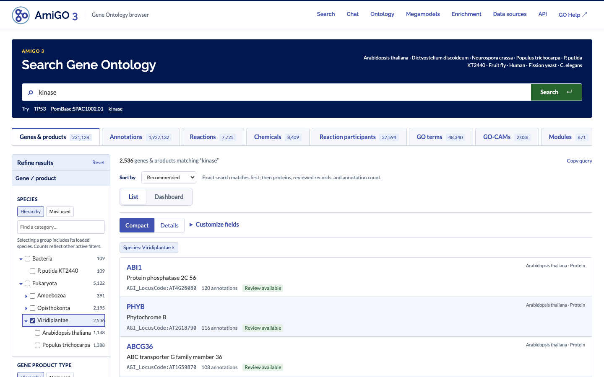

| | |
|---|---|
| 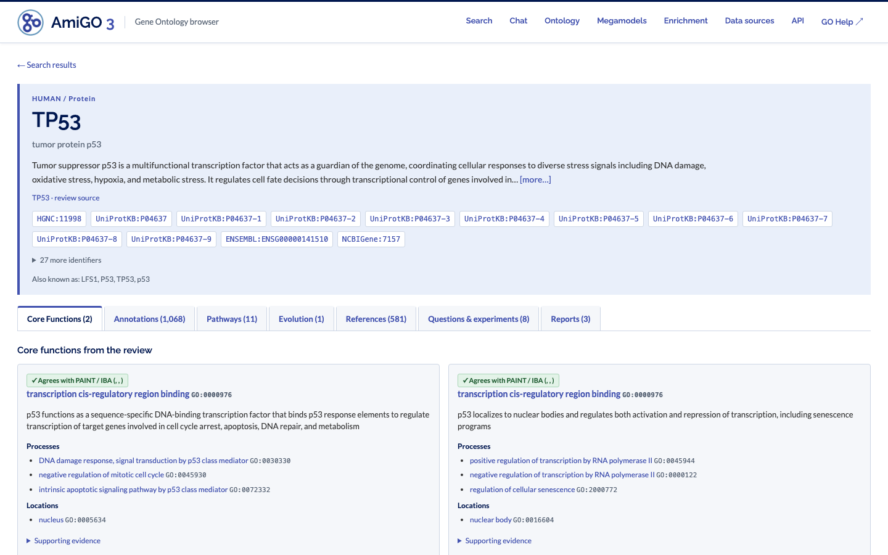 **Gene pages** lead with core functions from an AI gene review. | 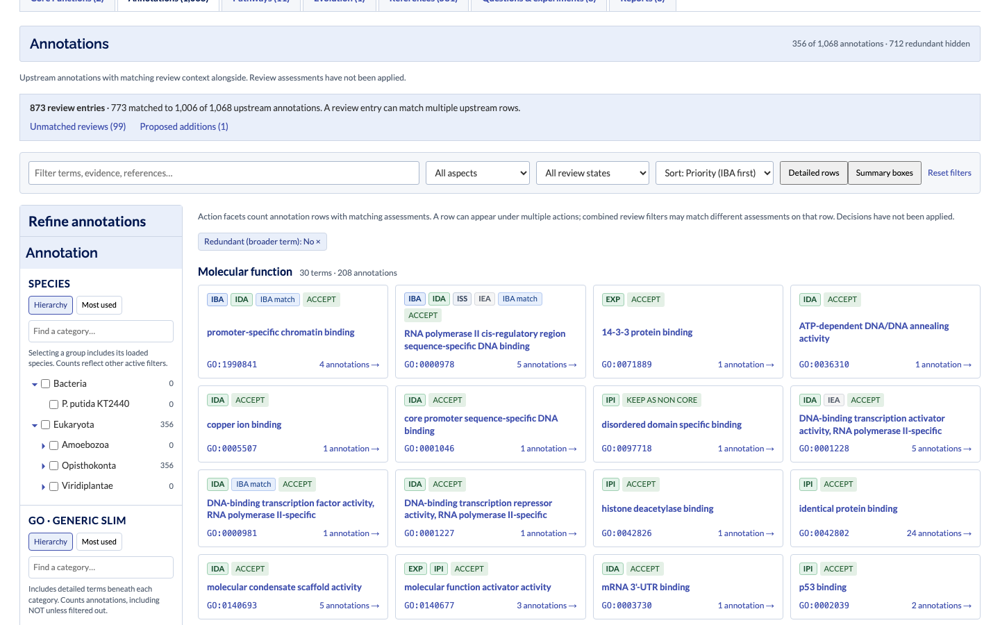 **Annotations** show review verdicts alongside, as rows or summary boxes. |
| 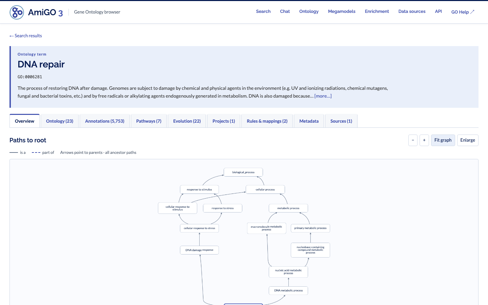 **GO terms** show every path to the root. | 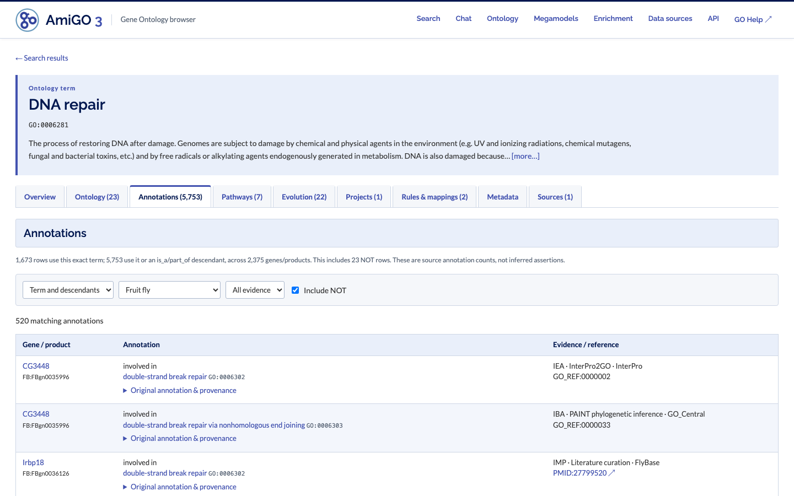 **Term annotations** cover descendants, filterable by species and evidence. |
| 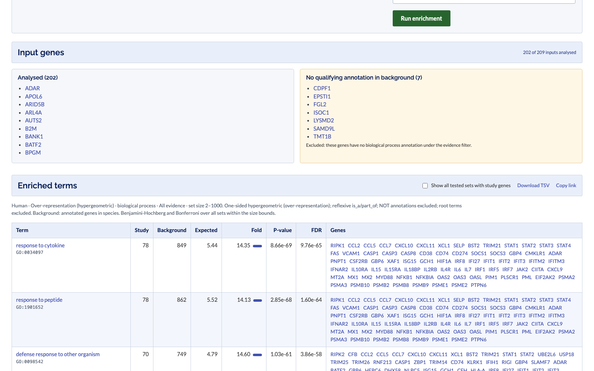 **Enrichment** against GO terms, MGSA or GO-CAMs. | 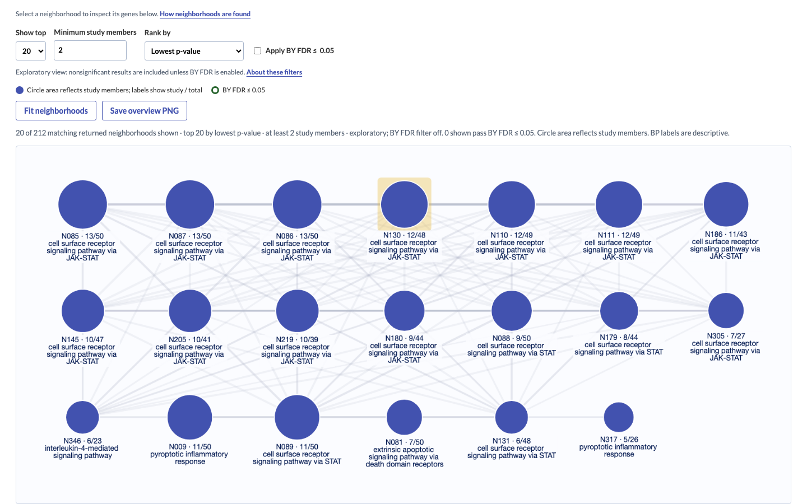 **Network enrichment** finds connected GO-CAM neighborhoods. |
| 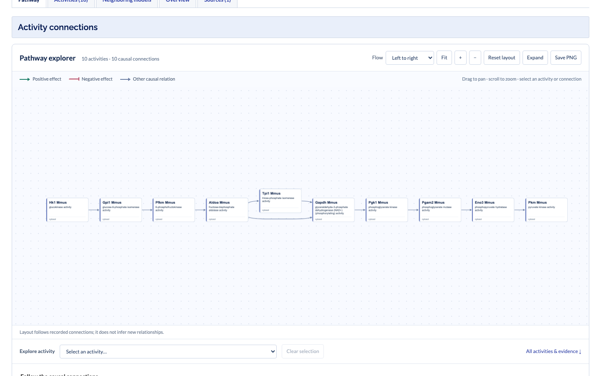 **GO-CAMs** as interactive pathways. | 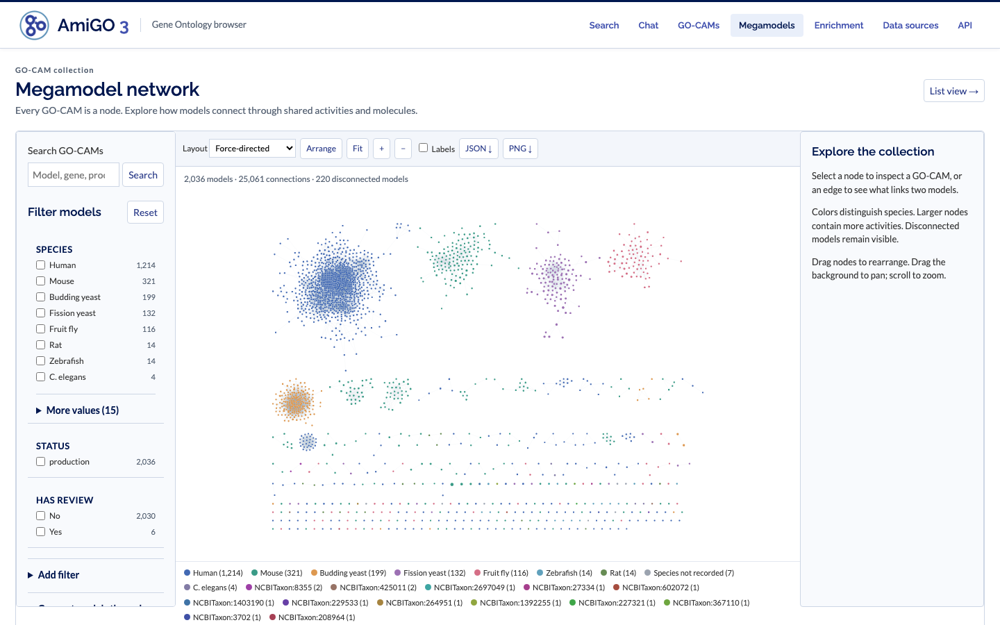 **Megamodels** connect every GO-CAM through shared activities. |
| 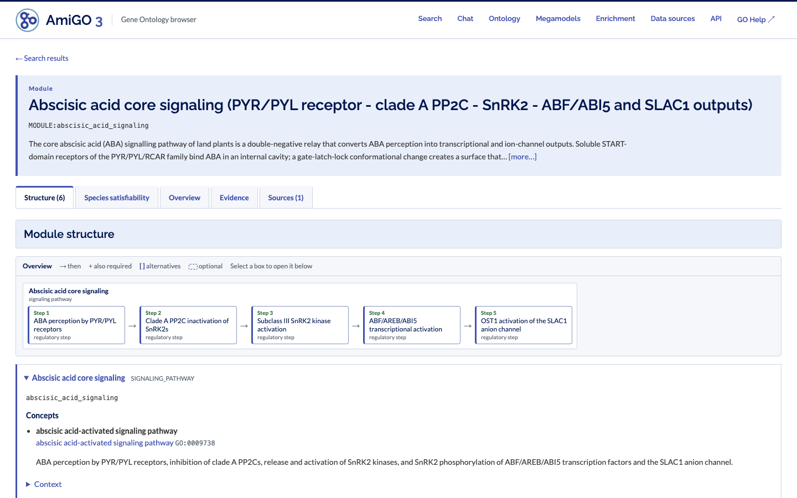 **Modules** describe pathways as steps and alternatives. | 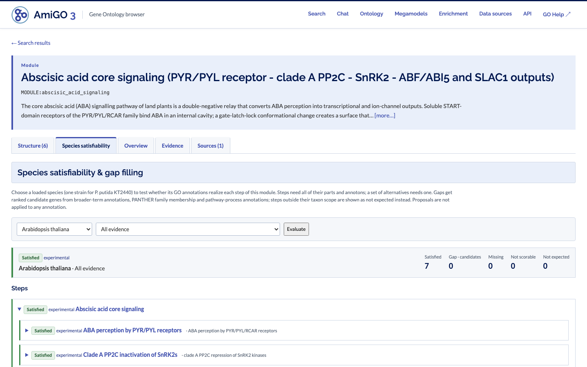 **Gap filling** checks which steps a species' genome satisfies. |
| 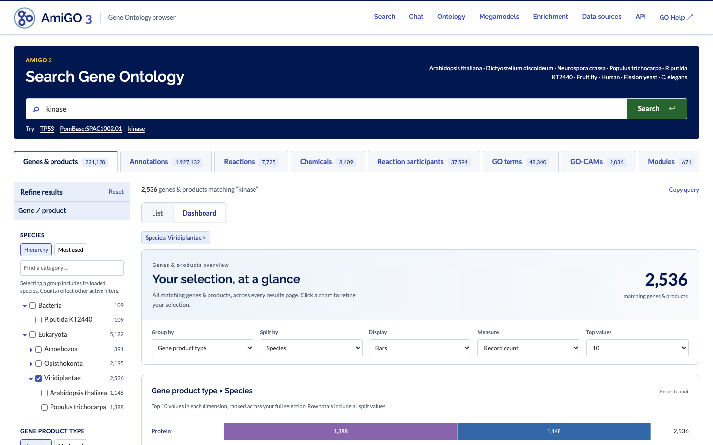 **Dashboards** summarize any selection. | 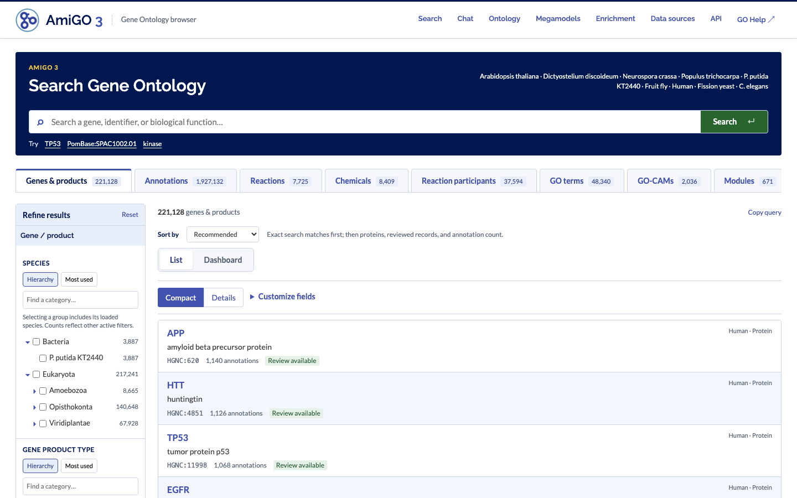 **One search** spans genes, annotations, terms, reactions, chemicals, GO-CAMs and modules. |

Video tours on YouTube ([playlist](https://www.youtube.com/playlist?list=PLI7hQmFd-HlE)):

- [Search and faceted browsing](https://youtu.be/nbRrgzrmFI0)
- [Gene pages with AI gene reviews](https://youtu.be/pgH6i5bB2zc)
- [Browsing GO terms](https://youtu.be/YawN0ct41iU)
- [Gene set enrichment and GO-CAM network neighborhoods](https://youtu.be/04Gk8DcWb40)
- [GO-CAM pathways and the megamodel](https://youtu.be/fO6QWoYfKA0)
- [Modules and gap filling](https://youtu.be/we3Jkw8AT8A)

Regenerate the screenshots and recordings with `just showcase` against a running server.

## Run

For a private EC2 deployment with Terraform, GitHub allowlists and centrally built
DuckDB/Solr releases, see [AWS deployment](docs/deployment.md). Hosted agent chat is
disabled in that deployment.

Requires `uv` and either Docker or Java 17+ for the pinned Solr 9.9.0 runtime.
`uv sync` also builds the `genesets` package (MGSA enrichment) from a pinned
git commit, which needs a Rust toolchain ([rustup](https://rustup.rs)) until
prebuilt wheels are published to PyPI.

```bash
uv sync
uv run amigo3 fetch
uv run amigo3 build

# Pick one:
docker compose up -d
# or: uv run python scripts/solr_local.py start

uv run amigo3 publish
uv run amigo3 serve
```

Open **http://127.0.0.1:8030**. API documentation: **http://127.0.0.1:8030/docs**.
Solr is bound to localhost on port 8987. API and browser use localhost port 8030.
`just` provides shortcuts for these commands.

To include AIGR reviews, GO-CAMs, modules and cached PANTHER families:

```bash
uv run amigo3 build --repository /path/to/ai-gene-review
uv run amigo3 publish
uv run amigo3 serve
```

Gene reviews are discovered across repository organism directories and attached by
explicit identifiers to loaded genes/products, including GAF-only subjects. Models,
modules and families are loaded across repository taxa; local gene links resolve
against the loaded species catalogs. `--reviews /path/to/genes` remains available for gene reviews alone.
See [loaded species and source policies](docs/species.md) for strain scope and identifiers.

[Preloaded external annotation sets](docs/predictions.md) appear under **Predictions**.
The NCBI KT2440 example compares mapped RefSeq GO annotations with the frozen UniProt
baseline, preserving source evidence and downloadable differences.

List remains the default view. Every collection offers a **Dashboard** of all records matching
its search and filters. Compare product types, species, GO subsets, model status,
research providers, project tags, and other collection-specific categories using bars
or a heatmap. Switch between counts and percentages; click a chart to filter, then
return to List to inspect the records. Settings are remembered per tab and shareable
in the URL. Multivalued groups count each record once per group (groups may overlap);
splits use single-valued fields so segments and percentages remain additive within a row.
GO-CAMs and modules also offer [quantitative facets](docs/quantitative-facets.md):
range sliders over structural measures (for example, the longest causal path, the number of OR
branch points, or the number of distinct realizations), with histograms and a joint heatmap on the Dashboard.
Term Metadata lists linked GO subsets/slims. Enrichment starts with Human when available;
explicit species in shared links and subsequent selections take precedence.

The [GO-CAM megamodel network](docs/megamodels.md) at `/megamodels` displays every
GO-CAM by default, with collection filters and configurable connections through
shared activities and chemical outputs/inputs. Switch between list and network
views with the same query. To start from one model and expand into neighboring
activities, open the **Neighboring models** tab on its GO-CAM page.

Review documents are snapshotted into
DuckDB with their paths and checksums. Dedicated `/genes/{id}` pages show the
review summary in an expandable gene header, followed by **Core Functions**,
**Annotations**, **Pathways**, **Evolution**, **References**, and **Reports** tabs. Pathways contains
GO-CAMs and modules; Evolution contains families. Tab labels show counts. Core
Functions includes locations, complexes, isoforms, knowledge gaps, proposed terms,
questions and experiments; it becomes **Review overview** when only other review
details are available, and is omitted when empty. All annotations remain available,
with visible review rationales (expandable when long), proposed replacements and
propagation assessments alongside each row. Evidence and provenance expand inline. Gene links support
normal navigation, bookmarks, reload and opening in a new tab.

References provides a searchable bibliography with reference assessments, findings,
and citation links back to their context. It is omitted when no bibliography is
present. Review coverage distinguishes review entries from upstream rows; unmatched
assessments and proposed additions have separate, directly linked sections. Those
sections are independent of upstream annotation filters. Populated fields without
a specialized presentation remain available as labeled nested fields, including
explicit false/zero values. Everything comes from the frozen review document;
these display improvements require no rebuild of existing full snapshots.

Review context is matched by subject, GO term, evidence code, reference, negation
and isoform. The YAML generally lacks relation, extension and with/from keys, so
this is explicitly context matching, not exact annotation adjudication. All
matching entries are retained. Proposed additions and unmatched entries are shown
separately; decisions are **not applied** to upstream annotations. The input
repository is never modified. Older builds without full review snapshots retain
summary-only context until rebuilt.

GO terms have dedicated `/terms/{id}` pages with definitions, typed ontology
relationships, and paginated annotations for the exact term or its descendants.
Their Overview includes a layered ancestry graph with all `is_a`/`part_of` paths
to root, shared ancestors, typed arrows, term inspection, zoom and an enlarged
view. The accompanying text view preserves keyboard access if graph loading
fails. Child branches expand on demand; **+ graph** adds a child's ancestor paths,
and **Reset graph** returns to the page term. Other relationship types remain in
the Ontology tab and do not enter the ancestry or annotation closure.
Synonyms, alternate IDs, aspect and status live in a compact **Metadata** tab
after related records. **Rules & mappings** shows SSSOM subjects, predicates
(including the full predicate ID and any modifier), and objects directly in the
related-record summary; the full mapping record retains its source context.

Child counts include descendants, with direct counts alongside. Species,
evidence and NOT controls also update the Annotations tab and persist in the URL.
Checkboxes select an OR of branches for **Browse selected branches**, preserving
those filters in the annotation search. Shared descendants count once per branch;
sibling counts overlap. Zero-count branches remain visible unless explicitly
hidden. Selections are shared across multiple parent paths.

Detail pages keep available descriptions in expandable headers and show counts on
collection tabs. Terms open on **Overview**, GO-CAMs on **Pathway**, modules on
**Structure**, families on **Members**, and rules/mappings on their assertion or
conditions. Related **Pathways** (GO-CAMs/modules) and **Evolution** (families) have
separate tabs, alongside reports, projects, or rules where present. Empty optional
related, family review/subfamily/PAINT, and module evidence tabs are omitted.
Reports and projects keep their narrative and contents links together, with
separate tabs for files/resources, related records and provenance as applicable.
All use the same keyboard-accessible tabs. Only the active panel is shown;
filters and graph selections survive switching tabs. Existing section and activity
bookmarks select the appropriate panel, including on reload and back/forward
navigation. Graphs initialize when opened.
All nine collections have search and facets. GO-CAM, module and family results open
bookmarkable pages at `/gocams/{id}`, `/modules/{id}` and `/families/{id}`:

- **GO-CAMs:** an interactive Cytoscape.js/Dagre pathway view with directed layout,
  readable activity cards, positive-effect arrows and negative-effect inhibition bars.
  Pan, zoom, drag nodes, change flow direction or export a PNG. Selection shows
  neighboring activities and exact relationship evidence inline. A keyboard selector
  and the complete activity/edge tables provide alternatives to canvas interaction.
  Participants, causal predicates, evidence and repository reviews remain available;
  enabled-by participants remain distinct from input/output molecules.
- **Modules:** nested parts, annotons, alternative variants, concepts, evidence and
  GO-CAM grounding. Representative proteins illustrate roles, not exhaustive membership.
- **Families:** official PANTHER names, reviews, subfamilies, searchable cached
  members and PAINT ancestral assertions. Cached inventory counts are distinguished
  from full catalog counts. PAINT rows are not converted into inferred member annotations.

Gene and term pages link to related records. Repository sources are frozen with
checksums and can be opened from each detail page. No live repository reads are
needed when serving a published build.

### Module satisfiability

Module pages have a **Species satisfiability** tab: choose a loaded species to see
which module steps its GO annotations realize (respecting parts, optional parts and
alternative variants), with ranked gap-filling candidates from broader-term
annotations, PANTHER family membership and pathway-process annotations. Proposals
can be downloaded as TSV and are never applied. See
[module satisfiability](docs/satisfiability.md).

### Gene set enrichment

For a GO-CAM-derived functional gene network, `amigo3 gene-network` exports the
combined graph with source assertions and a per-species coverage/component
report. **Network neighborhoods (GO-CAM)** tests connections from your list to
overlapping local neighborhoods built with personalized PageRank, using
degree-matched random sets.
Its primary view is an interactive neighborhood network with gene-level expansion
and source evidence; GO labels provide descriptive context after neighborhoods
are fixed.
**GO-term connectivity (GO-CAM)** retains the alternative test against GO-annotated
gene sets. See [GO-CAM gene network and enrichment](docs/gene-network.md) for the
neighborhood policy, null model, API and limitations. The over-representation and
MGSA methods test gene-set membership.

The **Enrichment** navigation item (`/enrichment`) runs a gene-set
analysis for a pasted gene list against the pinned build, testing either **GO terms**
or **GO-CAM models**. Choose the species, set size bounds and, optionally, a custom
background list. For GO terms, also choose the aspect (process, function or
component) and an evidence preset (all, exclude IEA, experimental only, or IBA only).

- **Inputs** resolve within the selected species: identifiers first (including bare
  UniProt/PomBase/WormBase accessions), then symbols, then synonyms, case-insensitively.
  Symbols that match several records are reported as ambiguous and left out;
  unresolved inputs and duplicates are listed rather than silently dropped.
- **Counting:** positive annotations are propagated over the reflexive is_a/part_of
  closure and counted once per gene and term. NOT annotations never count; root
  terms are not tested.
- **GO-CAM models:** a model's set is the loaded genes it references, in any
  participant role (activity enablers, and gene products used as inputs or outputs),
  resolved through the same explicit identifiers as model pages. Membership does not
  say which role a gene plays. Aspect and evidence presets do not apply. Models in
  every status (production, development, …) are tested; the status is shown with
  each result.
- **Background:** by default every gene in the species with at least one qualifying
  annotation in the aspect, or, for GO-CAMs, every gene of the species in at least
  one model. Study genes without one are listed and excluded. A
  custom background is intersected with the annotated genes.
- **Exclusions (GO only, both off by default):** *Exclude anti-slim terms*
  (`"exclude_anti_slim": true`) does not test terms in the GO do-not-annotate subsets
  (`gocheck_do_not_annotate`, `gocheck_do_not_manually_annotate`), which are too
  general to interpret; annotations to their descendants still count, and the
  correction covers fewer tests. *Exclude annotations flagged by AI gene review*
  (`"exclude_review_flagged": true`) drops annotations with any matching
  assessment of `REMOVE` or `MARK_AS_OVER_ANNOTATED` before propagation, so a gene
  keeps a term if another annotation supports it. Both persist in the shared URL.
- **Statistics:** one-sided hypergeometric test, with Benjamini-Hochberg FDR and
  Bonferroni corrections over **all** sets within the size bounds, including those
  with no study genes.
- **Model-based (MGSA):** the **Method** selector (API `"method": "mgsa"`) scores the
  same sets jointly with Bayesian model-based gene set analysis (Bauer, Gagneur &
  Robinson 2010; the collapsed model of Holmes & Mungall's wtfgenes). It looks for
  the few active sets that best explain the study genes, so parents and overlapping
  neighbors of an enriched term are explained away instead of listed alongside it.
  Each set gets a posterior probability of being active; the threshold becomes
  "posterior ≥" (default 0.5) and FDR stays in the TSV for comparison. Sets with
  identical genes in the background are merged and shown on the most specific term
  ("same genes as …"). The sampler is seeded, so a run is reproducible;
  `mgsa_samples_per_term` (default 100) trades time for precision. It runs in Rust
  through the [genesets](https://github.com/monarch-initiative/genesets) Python
  package; the Ontologizer example lists (969 study genes) take about 3 s on human GO.

**Example and searchable gene sets.** The form can be filled from a gene set
instead of a pasted list. These are study sets *for* GO enrichment, so they must
be independent of GO: GO term sets (MyGeneset's own and MSigDB's C5 GO
subcollections) are never searched or loaded.

- **Bundled examples** are expression-derived MSigDB signatures (Hallmark, C8 cell
  types, C2 chemical/genetic perturbations; CC BY 4.0) frozen from
  [MyGeneset](https://mygeneset.info/) into `src/amigo3/example_genesets.yaml`, so
  they need no network access. Each carries the GO terms its curated interpretation
  expects, from the [genesets](https://github.com/monarch-initiative/genesets)
  curation corpus; after a run, matching result rows are marked and the page counts
  how many expected terms reached the FDR threshold (exact term match). Regenerate
  with `uv run python scripts/fetch_example_genesets.py --interpretations ../genesets/curation/genesets`.
- **Live search** proxies the MyGeneset API through
  `GET /api/genesets/search?species=…&q=…&collection=…`, limited to the selected
  species and to non-empty sets. Collections: `signatures` (default; MSigDB H,
  C2:CGP, C4, C6, C7, C8), `regulatory` (C3 TF/miRNA targets), `chemicals` (CTD),
  `disease` (Disease Ontology, HPO), `pathways` (Reactome, WikiPathways, SMPDB,
  C2:CP) and `all`. Human is well covered; C. elegans has CTD and WikiPathways
  sets; fission yeast has no non-GO sets in MyGeneset. Disable live search with
  `amigo3 serve --genesets-url ''`; bundled examples remain.
- `GET /api/genesets/{id}?species=…` maps the set's members onto the pinned build:
  NCBI Gene, then UniProt, then Ensembl/WormBase/PomBase identifiers, then symbols.
  The study list gets readable symbols (or IDs where a symbol would resolve to a
  different gene); unmapped members stay in the list so the enrichment report shows
  them as not found. Membership is MyGeneset's as published, including its own
  identifier mapping. GO-derived set IDs are refused with 422.
- The page states the collection, links the source record, says whether the set
  was bundled or fetched live and how many members mapped, and keeps the set's ID
  in the shareable URL.

Results link to term, GO-CAM and gene pages, can be downloaded as TSV (with build and
parameter headers), and the page URL reproduces the run. The API is
`GET /api/enrichment` (species with annotated and GO-CAM gene counts, gene set
sources, aspects and evidence presets) and `POST /api/enrichment`, where
`"target": "gocam"` selects models (the default is `"go"`):

```bash
curl -s http://127.0.0.1:8030/api/enrichment -H 'Content-Type: application/json' \
  -d '{"genes": ["BRCA1", "BRCA2", "RAD51", "ATM"], "species": "human", "aspect": "P", "evidence": "no_iea"}'
```

GO-CAM enrichment needs a build made with `--repository`. Enrichment reads the
integration DuckDB of the pinned build, so it works with either serving backend.
Review decisions are not applied to the annotations used unless
`exclude_review_flagged` is set.

### Optional GitHub login

Set `AMIGO3_GITHUB_CLIENT_ID`, `AMIGO3_GITHUB_CLIENT_SECRET`, and
`AMIGO3_AUTH_ORIGIN` to add GitHub sign-in and require it for chat. Public browsing
stays available. Login sessions live in memory and reset on restart; no database
is needed. See [login setup](docs/login.md). Chat remains local-only.

### Agentic research chat

Open the **Chat** navigation item for multi-turn agent sessions with streamed
answers, plans, tool activity, permission choices, cancellation, and transcript
downloads. Agents can inspect the schema and query the server's pinned DuckDB
build through read-only MCP tools, with source provenance available alongside the
results. The browser uses ACP, so the agent is configured independently of the UI.

```bash
uv sync --extra chat
npm install -g @agentclientprotocol/claude-agent-acp  # Node.js 22+
# Use your existing Claude authentication / provider credentials.
uv run --extra chat amigo3 serve --backend duckdb --chat-command 'claude-agent-acp'
```

For local testing, `just serve` (Solr) and `just local` (DuckDB) always enable
chat and include its Python dependencies. Install the ACP adapter above first.
Both recipes accept extra server options, including `--chat-command` to select
another adapter. Direct `amigo3 serve` invocations require `--chat-command`.

Open **http://127.0.0.1:8030/chat**. Chat is local-only. Sessions survive
Back navigation and reload, including active turns, for up to 30 minutes away from
Chat. The Sessions sidebar lists conversations by their first question, with activity
status and message counts. New session keeps earlier conversations available;
switch between them or delete them from the list. Server restarts clear in-memory
sessions. Waiting approvals are highlighted in the session list. Choose **Allow
all** for one session or as the global default; session overrides take priority.
**Workspace files** lets you browse, preview and download files created by the
agent. Workspaces are temporary and share the session lifetime.
The database tools are read-only; other agent capabilities follow its own
permissions. See [chat.md](docs/chat.md) for setup, architecture, tool limits,
existing UI options evaluated, and verification.

### Projects

The **Projects** tab indexes top-level `projects/*.md` pages (excluding README),
with facets for maturity, tags, declared species and project collections. Dedicated
`/projects/PROJECT:{slug}` pages retain the narrative, tables, section navigation,
source metadata and checksums, plus supporting file downloads and external links.
Nested supporting documents remain resources, rather than duplicate projects.
The page header shows the main artifact (frontmatter `primary_artifact`, else
`manifest` entries, else the shallowest linked HTML/PDF page or report), status,
dates (`created`, `updated`, ...), owners/authors and tags. Resources are labelled
by link text with their project-relative path, so nested `index.html` files differ.

Related records come from declared species/gene pairs, explicit identifiers,
UniProt table columns and source links. Project-local research reports are linked
by their source directory. These are references, not assertions that every mentioned
gene is a project member or has been reviewed. Gene links cover the loaded catalogs;
all declared genes and species remain visible. Genes, terms, modules, GO-CAMs,
families and reports link back to referencing projects. Original Markdown and
explicitly linked local files are frozen in the build; HTML resources download
separately. Project pages and files require no live repository access.

The detail API is `/api/projects/{id}`; search uses the generic `projects` collection.

### Rules & mappings

The **Rules & mappings** tab indexes SSSOM mappings, ARBA/UniRule review records,
conditional Proteostasis mappings and Pfam annotation proposals. Each record opens
`/rules/{id}`, with source fields, conditions, existing assessments and immutable
provenance. Rule conditions retain OR/AND grouping and negation; omitted conditions
are explicitly marked. Mapping-set descriptions explain project-specific predicate
conventions. Rules are not executed against the annotation catalog.

Browse by record type, source, structured review status/action, propagation scope
or mapping predicate. Projects link to their mapping sets; GO, family and gene
pages link to structured references. See [the data model and source inventory](docs/rules-and-mappings.md)
for review formats, identity limitations and future review targets. The deferred
embedding, mega-model and reaction-link ideas are in [advanced views](docs/advanced-views.md).

### Research reports

The **Reports** tab searches deep research and focused hypothesis reports, including
OpenScientist and Falcon/Edison. Filter by provider, report type, subject type,
organism, or artifact availability. Results open `/reports/{id}` reading pages with
a contents list, tables, local figures, original question, metadata and downloads.
Gene and module pages link to reports through explicit identifiers or source context.

`--repository` discovers `*-deep-research*.md` in genes, modules, terms, rules,
projects and interpro, plus OpenScientist/Falcon/Asta reports under gene hypothesis
folders. Citation sidecars, prompts and generated artifact folders are excluded as
standalone results. Reports cover all repository organisms; gene links resolve only
against the loaded catalogs. Report prose is searchable but does not create annotations.

Markdown sources and available local artifacts are copied into the immutable build.
Serving needs no access to the original repository. Original bytes, paths and SHA-256
checksums are retained; missing artifacts are identified on the report page. HTML
is escaped in the reader; HTML/PDF attachments download separately. Remote images
are represented by their alt text. The API exposes `/api/reports/{id}` and
`/api/report-assets/{sha256}` alongside the generic reports collection query.

Deployment estimates for the prototype, reference species and all-UniProt projections
are in [deployment-costs.md](docs/deployment-costs.md).

### Result display

Every collection has a **Sort by** menu. **Recommended** puts exact ID/name search
matches first, then uses collection-specific preferences: proteins, reviews and
annotation counts for genes; non-redundant, IBA and experimental evidence for
annotations; `goslim_generic` membership for terms; review/size for models, modules
and families; recency for reports; and resource counts for projects. Name, ID, and
relevant count/date/agreement/term alternatives are available. Sorts apply to the
full selection, reset pagination, and survive shared URLs and history.

Term browsing starts with a visible **Obsolete: No** filter. Remove that chip to
include obsolete terms; the choice survives reload, while **Reset** restores the
active-only default. Explicit obsolete filters and direct term pages still work.
The **GO subset / slim** facet selects direct subset membership, including
`goslim_generic`; it does not expand to descendants like the annotation GO-slim facet.

Every collection starts with minimal **Compact** cards and offers **Customize
fields**. Genes, terms, GO-CAMs, modules, families, reports, projects and rules
also offer a **Details** preset with useful fields for that datatype. Selected
fields appear inline; long values expand in place. Field choices are independent
for each tab while browsing, and the current collection's choices are saved in
its URL for bookmarks and return navigation from detail pages.

### Annotation display and review filters

Annotation search starts in **Compact** view. **Review** adds matching assessment
summaries, action badges, rationale excerpts and proposed replacement terms.
**Customize fields** adds subject IDs, with/from, extensions, annotation dates or
source datasets. Full review rationale, quotations, additional references and
provenance expand inline; an expand/collapse control works on the current page.
Display presets and selected fields are saved in the URL and retained when
returning from a gene page. They do not alter the annotation filters.

**Gene review available** (`has_review`, retained for existing links) and
**Matching assessment available** (`has_annotation_review`) are distinct. Selecting
review coverage, or displaying assessments, reveals the action facets. **More
review filters** reveals replacement terms, supporting evidence availability and
multiple matches. **Add filter** can reveal a facet at any time; active filters
remain visible even when the condition that first revealed them is removed.

Gene browsing follows the same disclosure pattern: **Gene review available = Yes**
or displaying review actions, summary, or source reveals **Review action**. It stays
hidden in ordinary compact browsing unless explicitly added or already filtered.
Gene action counts cover any action in the gene's review, including proposals;
an evidence-code filter and an action filter may refer to different annotations.

Actions are projected from matched annotation assessments during the build,
using the same conservative matcher as the gene page. A facet counts annotation
rows, once per action; a row with multiple actions contributes to multiple buckets.
Combined review filters operate across the row’s assessments, so action and support
filters can be satisfied by different matching entries.
`NEW` proposals and unmatched review entries remain on gene pages and do not acquire
upstream annotation rows. Full assessment records stay in the integration snapshot;
only their query fields and identifiers are projected to Solr. Annotation text
search includes matched review summaries and rationales.

For local analysis or browser development without Solr:

```bash
uv run amigo3 serve --backend duckdb
```

DuckDB is also a reference implementation for testing filter/facet semantics.
Its text search uses case-insensitive substring tokens; Solr uses analyzed tokens,
so text-search result sets need not be identical. Exact filters and facets share
one contract. The default serving backend is Solr.

## Pipeline

1. **Fetch:** `config/sources.yaml` lists human, pombe and worm GAF/GPI, KT2440 GOA GAF, HGNC, GO-basic,
   and the ECO evidence-code mapping. Raw bytes are cached with SHA-256 hashes.
   `fetch` reuses intact cached inputs; `fetch --refresh` advances them explicitly.
2. **Stage:** parse GAF 2.2 and GPI 2.0, retaining source rows and line numbers.
   The published GO Standard Annotation Schema package supplies the GPI reader.
3. **Integrate:** DuckDB holds entity catalogs, identifier links, source
   annotations, ontology edges, and the final query tables.
4. **Export:** immutable Parquet files for all six collections
   plus a manifest and reconciliation report under `data/builds/<build-id>/`.
5. **Publish:** stream Parquet batches to a dedicated `amigo3_<build-id>` Solr core,
   check record counts, then publish a local pointer. An API process pins one build
   on startup. Restart it after publishing a new build to advance the browser.

All downloads, databases, indexes, and generated reports are git-ignored. Failed
builds stay in `.building` directories and never replace the current build pointer.
Old builds and cores are retained; automatic retention/garbage collection is not
implemented. Full rebuilds are the initial update mechanism.

`current.geneontology.org` inputs are frozen by their bytes and source headers,
not assumed to be today's release or mutually synchronized with HGNC. Use dated
release URLs in the source configuration when a coordinated GO release is needed.
The build records GO's ontology version and each file's headers. The ECO input
supplies default GAF-code mappings, not all GO_REF-specific refinements.

## Identity and biological context

- HGNC and PomBase provide preferred gene-level display IDs where established.
  UniProt, HGNC, MOD, and Ensembl identifiers remain searchable and resolvable.
- Gene symbols are labels, never join keys. Ensembl versioned IDs retain their
  original spelling plus a versionless search alias. Known prefix anomalies are
  normalized without changing the cached source records.
- A product can map to multiple genes. Ambiguous HGNC mappings remain separate
  product records and are reported; the importer never picks one arbitrarily.
- Original annotation subjects, including isoforms, stay intact when grouped on
  gene pages. **Gene product type** facets distinguish proteins, complexes, tRNAs,
  and other RNA types using supplied GPI/GAF types, independently of gene/product
  identifier namespaces. A record can have multiple types; each facet counts it
  once. Unspecified means the sources supply no product type (including catalog-only
  genes), not protein by default. `gene_product_type_ids` retains ontology CURIEs;
  DuckDB's `gene_product_type_sources` retains the contributing subjects and source
  assertions. Legacy `record_kind` filters remain supported for existing bookmarks.
- The product-type hierarchy groups RNA subtypes under **ncRNA**, with lincRNA
  and antisense lncRNA beneath **lncRNA**. It uses a curated Sequence Ontology
  `is_a` subset (intermediate classes omitted). `gene_product_type_groups` indexes
  reflexive ancestor membership as CURIEs, so parent filters include descendants
  and counts deduplicate records with multiple types. Types supplied only as ncRNA
  also count under that parent. `gene_product_types` remains the exact supplied-type
  filter; neither cards nor source assertions are replaced with inferred ancestors.
- The full GPI catalogs are retained in `entities`. The browser includes HGNC
  genes, PomBase and WormBase primary objects, explicitly mapped GPI objects, and annotated
  subjects; it does not call every unannotated RNA product a gene.
- GAF relation labels, NOT, evidence codes, references, interacting taxa,
  annotation extensions, and with/from expressions are preserved. OR/AND groups
  have explicit JSON representations instead of being flattened into a conjunction.
- `is_a_closure` and `isa_partof_closure` are separate, reflexive closures computed
  from GO-basic. Regulatory edges are excluded. Gene-level positive term summaries
  exclude NOT annotations. Filtering annotations by term ancestry finds annotations
  *using* those terms, including NOT if not separately filtered; it is not a claim
  of entailment for every relation.
- The browser is permissive about published entity rows that fail the stricter
  SAB authoring schema: it preserves those rows and records the validation warning.
  Structural GAF/GPI column/version errors fail the build. See `report.json`.

## Generic API

`GET /api/collections` discovers collections, fields, types, default facets, and
capabilities. LinkML projection definitions live in `schema/amigo3.yaml`; runtime
field types are checked against the Parquet schemas. Presentation defaults live in
`src/amigo3/search.yaml`.

```bash
curl -s http://127.0.0.1:8030/api/query \
  -H 'Content-Type: application/json' -d '{
    "collection": "annotations",
    "filters": [
      {"id": "species", "field": "species", "op": "in", "values": ["human"]}
    ],
    "facets": {
      "species": {"field": "species", "exclude_filters": ["species"]},
      "evidence": {"field": "evidence_code", "limit": 30}
    },
    "select": ["id", "gene_symbol", "db_object_id", "ontology_class_id", "evidence_code"],
    "page": {"size": 20}
  }'
```

The response includes hits, totals, facets, build identity, and a continuation
cursor. Pass the cursor back in `page.cursor` with the same query. Optional `view`
must match the pinned build. Filters are ANDed; values within an `in` filter are
ORed. Supported operators: `eq`, `in`, `not_in`, `gte`, `lte`, `exists`.
Named filter exclusions support disjunctive facet navigation. Facet counts are
exact record counts in the single-core deployment; a `truncated` flag indicates
that only the top buckets were returned. Nested boolean filters, pivots, distinct
entity metrics, arbitrary sorting, and exports are later extensions.

A facet may specify `values` (1–200 typed values) instead of requesting top
buckets. This returns every distinct requested value in request order, including
zeroes, with `truncated: false`; `limit` is ignored. Named filter exclusions still
apply. The ontology child browser uses this mode for `isa_partof_closure` and
`ontology_class_id`, so an omitted top bucket cannot be mistaken for zero.
`GET /api/ontology/{id}?view={build_id}` supplies the complete typed ancestor DAG
and immediate hierarchy children, including whether each can be expanded.
Alternate IDs resolve to the primary term. A stale build is rejected.

### Hierarchical facets

Species facets on the genes and annotations tabs offer **Hierarchy** and **Most
used** views. The annotations tab also offers **GO · generic slim**. Expand arrows
navigate independently of checkboxes; category search reveals matching nodes and
their parent paths. Selections survive shared URLs, reloads, and back/forward.

The build reads actual `subset: goslim_generic` tags from the pinned GO-basic
source, adds the three aspect roots, and connects each displayed term to its
nearest displayed ancestors through `is_a` and `part_of`. Multiple parents are
retained. Detailed annotation terms map to every applicable slim ancestor even
when intermediate terms are hidden. Unused categories are pruned; unknown and
obsolete terms appear under **Unmapped / obsolete GO terms**, and alternative IDs
resolve to their active primary IDs. Regulatory relations do not enter the mapping.

Species use the small curated NCBI Taxonomy subset in `src/amigo3/hierarchies.py`:
human and worm under Metazoa, fission yeast under Fungi, both clades under
Opisthokonta, and P. putida KT2440 under Bacteria. Fission yeast includes its
[strain 972 taxon](https://rest.uniprot.org/taxonomy/284812) beneath the species.
New taxa remain selectable as
ungrouped roots until their grouping is added there; no taxonomy downloads occur
at query or build time.

Indexed `go_slim` (annotations) and `taxon_groups` (genes and annotations) arrays
use the ordinary query/filter API in both Solr and DuckDB. Values within a facet
are ORed; different facets and text search are ANDed. Each node counts distinct
records matching the other active filters, excluding its own selection. An
annotation reached by two parent paths counts once; sibling counts need not sum
to their parent's count. GO facets include NOT annotations unless the negation
filter excludes them. Gene-tab species counts count gene/product records.

Hierarchy metadata lives in the immutable build manifest and is exposed through
`/api/collections`. Tree requests ask for all their node buckets (the facet limit
allows up to 1,000), rather than assuming an omitted top-value bucket has no hits.
Rebuild, republish to Solr if used, and restart the API to enable the new fields.
Older builds retain their existing flat facets until rebuilt.

Other endpoints:

- `GET /api/resolve?identifier=UniProtKB:Q9US57` — possibly multiple matching records.
- `GET /api/records/{collection}/{id}` — complete projected record.
- `GET /api/genes/{id}` — complete annotation set and frozen review context for a gene.
- `POST /api/annotation-reviews` — frozen assessments for up to 100 annotation IDs, optionally pinned with `view`.
- `GET /api/terms/{id}` — term, typed neighborhood, annotation counts and related records.
- `GET /api/resources/{collection}/{id}` — GO-CAM, module, family or rule/mapping with frozen source documents.
- `GET /api/snapshots/{sha256}` — original repository source bytes.
- `GET /api/provenance/{annotation-id}` — original GAF row and source manifest.
- `GET /api/manifest` and `/api/report` — build provenance and integration findings.
- `GET /api/health` — checks the active query backend.

## Development and verification

[GitHub Actions CI](https://github.com/geneontology/amigo3-prototype/actions/workflows/ci.yml)
runs on pushes to `main`, pull requests and manual dispatch. It checks Python lint
and formatting, JavaScript syntax, and source/wheel builds. The Python unit/API/integration suite
runs on Python 3.11 and 3.12 with a disposable Solr 9.9.0 service, so the Solr
roundtrip/parity test is included. Tests use synthetic fixtures; no upstream GO
release or AIGR checkout is required. A separate Chromium job runs the browser journeys in `tests/browser/` against
an extended synthetic dataset. It covers search and pagination, gene reviews and
provenance, contextual review facets, term scope and NOT filtering, module variants,
family member filters, reports and downloads, project links, rule conditions,
GO-CAM graph interactions and failures, all nine mobile collection views, and
field choices across cached upgrades. Dependencies come from `uv.lock`.

The real-data browser scripts and full-dataset verification below remain local
checks; CI does not download or build the production annotation index.

Each browser test gets an isolated context. On failure, it saves viewport and
full-page screenshots, a browser log (including page URLs and JavaScript/network
errors), and a Playwright trace with DOM snapshots and network activity. Actions
uploads these as **browser-failures**, retained for 14 days. Download the artifact
from the failed run and inspect a trace locally:

```bash
uv run playwright show-trace path/to/trace.zip
```

Local diagnostics go to `data/browser-failures/` (override with
`AMIGO3_BROWSER_ARTIFACTS`). Passing tests discard traces; failure files from older
local runs remain until removed. JavaScript exceptions also fail tests. Tests use
visible-state assertions rather than fixed sleeps for browser interactions.
These functional and responsive checks complement human visual review; there is
no pixel-by-pixel screenshot comparison or full accessibility audit yet.


```bash
uv run ruff check .
uv run ruff format --check .
uv run pytest
# Include real Parquet → Solr roundtrip and facet parity tests:
AMIGO3_TEST_SOLR=http://127.0.0.1:8987/solr uv run pytest
# Verify the complete downloaded dataset against Solr:
uv run python scripts/verify_live.py
# Reproducible browser regression (also runs in GitHub Actions):
uv run playwright install chromium
AMIGO3_TEST_BROWSER=1 uv run pytest tests/browser
# Or use installed Chrome: add AMIGO3_BROWSER_CHANNEL=chrome
# Real-data browser smoke tests (use installed Google Chrome by default):
uv run python scripts/check_browser.py
uv run python scripts/check_resource_browser.py
uv run python scripts/check_review_browser.py
uv run python scripts/check_display_browser.py
uv run python scripts/check_report_browser.py
uv run python scripts/check_project_browser.py
uv run python scripts/check_rule_browser.py
uv run python scripts/check_graph_browser.py
```

The tests cover identifier/isoform grouping, ambiguous mappings, unannotated
catalog entries, NOT handling, closure semantics, source provenance, review matching and snapshot isolation, facet filter
exclusions, cursor binding, query validation, module alternatives, model participant
roles, PAINT negation, byte-exact repository snapshots, and optional live Solr parity.

## Browser styling

The browser uses GO/AmiGO-inspired colors, typography, tabs and annotation rows.
`src/amigo3/web/theme.css` contains shared design tokens and local font declarations;
`style.css`, `gene.css`, `resource.css` and `report.css` contain component styles. This is plain modern CSS and
JavaScript, with no legacy UI framework. Asset sources and font licenses are in
`src/amigo3/web/assets/`.

## Design lineage

See [docs/design.md](docs/design.md) for the specific ideas taken from go-db,
Patrick Kalita's Standard Annotation Backend/schema work, and linkml-store.
AmiGO 3 currently provides read-only integration and browsing. Changeset execution,
SAB synchronization, full phylogenetic trees, and an Elasticsearch publisher are
future work; the first publisher targets Solr.

The GO-CAM graph dependencies are pinned and served locally; see
[the vendor manifest and regeneration instructions](src/amigo3/web/vendor/README.md).
The layout preserves activity identity, parallel edges and cycles, and never adds
causal relationships. Node captions may shorten long labels; selecting a card
shows its full function and location. Colors summarize the recorded relation's RO
ancestry; the exact predicate and its source evidence remain inspectable.
