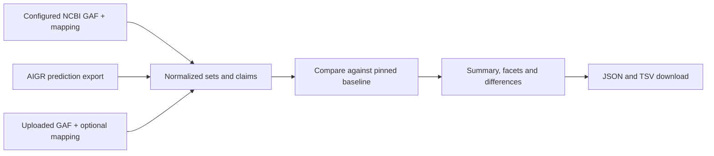

# External predictions and annotation-set comparison

Design proposal, 2026-10-18.
The first slice is implemented: configured GAF preloads, frozen source/mapping
artifacts, protein-level comparisons, and a `/predictions` browser with exports.
Category facets, gene-page Predictions tabs and taxon-labeled NCBI Gene
cross-references are also implemented. See [preload instructions](predictions.md).
Uploads, the AIGR adapter and project panels remain proposed below. The [RefSeq pilot](refseq-go-comparison.md)
prepares the initial KT2440 inputs.

## Product decision

Support preloaded sets and uploaded GAFs through one comparison service. A user
opens **Compare predictions**, selects a published set or uploads a GAF, chooses
a baseline from the pinned AmiGO build, and receives a summary with inspectable,
downloadable differences. Ordinary comparisons do not require an LLM.

NCBI PGAP fits as an **external annotation set** in this workflow. Preserve its
RefSeq attribution, IEA evidence, method references and HMM/architecture identifiers.
The role of a dataset in a comparison is independent of its scientific provenance.
A prediction, an external electronic annotation and a reviewed prediction can use
the same comparison machinery without claiming they are the same evidence type.

Published sets appear on project pages and in gene/term context. Uploaded sets use
the same views and comparison rules but remain temporary. Neither route adds claims
to the default annotation counts or enrichment inputs. A future explicitly selected
combined analysis can expose its source policy separately.

## Existing work to reuse

The AIGR checkout inspected was `d00415e9a6d83d80030610ea88875ac196fb0db4`:

- `docs/prediction_browser.md` describes a shared prediction browser with sets,
  claims and a dated GO-GPT overlap dataset.
- `src/ai_gene_review/export/prediction_export.py:collect_prediction_data`
  already collects canonical gene-side YAML, narrative outputs, source versions,
  project/cohort memberships, assessments and representation choices. Its output
  has `sets`, `claims`, `overlap` and `metadata` (`schema_version: 1`). Reuse this
  export contract through a versioned JSON/Parquet adapter; do not execute its
  generated `data.js` or import the browser JavaScript as data.
- `projects/BIOREASON_COMPARISON.md` distinguishes SFT GO predictions,
  GO-GPT terms, and BioReason RL functional narratives. GO-GPT terms included in
  a BioReason web report must retain their GO-GPT attribution.
- `projects/FUNCTION_PREDICTION_EVALUATION.md` links evaluations including
  ProtNLM, DeepECTransformer, BioReason, rules and external mappings.
- Canonical observations are under `genes/`; experiment copies under `projects/`
  are not additional observations. Project manifests and benchmark metadata
  contribute membership and provenance. Frozen benchmark overlap results retain
  their original reference snapshot and are not silently replaced by live comparisons.

Issue #8 is narrower and predates the shared export. Its proposed assessment
facets need `review_state` and assessment scheme alongside them: seeded/pending
UNC is different from reviewed UNC. Its generic confidence facet should be split:
AIGR's exported `review_score` is a VDCL review score (0–2), not predictor confidence;
BioReason narrative correctness/completeness use 1–5 scales.

AmiGO already has GAF 2.2 parsing (`parse.gaf_rows`), frozen source provenance,
subject/gene and identifier mappings, separate ontology closures, generic collection
facets, and request-time analysis against the pinned DuckDB build. The current
GAF adapter preserves empty symbols, relation, NOT, with/from Boolean groups,
extensions, taxon and product-form identity. Reuse it with an upload-specific
source descriptor and explicit taxon scope. Do not reuse enrichment's symbol/
synonym fallback for automatic protein mapping.

## Shared records

| Record | Responsibility |
| --- | --- |
| Source dataset/release | Provider, source kind, method/version, input hashes and dates, project/cohorts, taxa/assembly/proteome scope, publication or upload origin |
| Prediction/output set | Per-subject, source-document, method/version output; explicit empty output versus missing output; term claims versus narrative; source representation and review state |
| Claim | Original subject and taxon, optional resolved protein and gene link, term/vocabulary, optional GAF relation/NOT/evidence/extensions/form ID, source row, model score if supplied |
| Review | Recorded assessment scheme, score, rationale, evidence and reviewer provenance, linked to its exact claim/set snapshot |
| Mapping | Original subject → target subject with taxon, mapping method, evidence/hash, candidate count and resolution status |
| Comparison | Input hashes, baseline build and source/evidence policy, ontology version, mapping version, subject scope, filters and results |

Keep original and resolved IDs separately. Gene links provide navigation; the
comparison's subject unit is explicit (protein/product by default). Do not collapse
isoforms or multiple proteins of one gene simply because they share a gene page.
Preserve AIGR source-set identity inside larger preloaded collections.

GO claims enter GO comparison. EC claims and narratives remain browsable with
`not comparable to GO` status unless an explicit, versioned conversion is selected.
Missing relations on term-only YAML are reported as unknown; do not manufacture
full GAF assertions. Missing model scores remain missing. An empty GAF establishes
zero supplied rows, not which proteins were evaluated with an empty output.

## Identifier resolution and scope

1. Resolve exact normalized identifiers against the frozen protein/identifier catalog,
   with taxon checks and product boundaries.
2. Apply a supplied, versioned mapping artifact for external IDs. Accept only
   unambiguous, taxon-consistent mappings in the default comparison; show candidates
   for ambiguous mappings without multiplying claims.
3. The NCBI pilot's 4,501 sequence-identical, one-to-one matches can seed such an
   artifact. Each also has a versioned UniProt RefSeq cross-reference. Preserve
   sequence/mapping provenance; do not indiscriminately strip accession versions.
4. Report unresolved identifiers, ambiguity and taxon mismatches. An optional TSV
   mapping upload allows GAF users to resolve these without changing the source GAF.
   Exact sequence mapping requires separately supplied sequences or a prebuilt catalog;
   a GAF alone cannot perform it. Online mapping services are not a hidden per-row dependency.

Track **catalog membership**, **baseline scope**, and **annotation presence**
separately. The current PSEPK catalog is derived from annotated GAF subjects, not
all proteins in the proteome. The pilot's 248 additionally annotated proteins
were measured with an independent sequence catalog. A trustworthy "previously
unannotated" count therefore needs explicit mapping and scope/proteome membership,
even if the target has no local gene page. Unsupported species remain browsable
but outside the baseline comparison. An absent annotation in the selected baseline
is not absence from all of GOA.

Keep the evaluated protein cohort when supplied. A file of positive predictions
alone is not a complete evaluation universe, so it cannot establish recall or how
many proteins the predictor examined without making a prediction.

## Comparison result

Start with all published positive GO annotations in the selected taxa of the pinned
build; expose source/evidence filters as part of the recorded baseline policy.
Do not apply AIGR review actions to that baseline by default. A later post-review
baseline and core-function baseline must be separately named and versioned, matching
AIGR's existing three-level comparison rather than conflating those references.

The report shows:

- Input rows, distinct claims and subjects; duplicates and model/evidence breakdowns.
- Resolved, ambiguous, unmapped and out-of-scope subjects, with explicit denominators.
- Exact term matches, terms already covered by a more specific baseline term,
  candidate refinements of broader baseline terms, and other unmatched terms.
- Proteins receiving their first annotation **within the selected baseline scope**.
- Separate assertion-level comparison when relation, NOT, form and extension are
  available, and flags for explicit opposite-polarity assertions with compatible context.
- Unknown/obsolete GO IDs and alternative-ID normalization; retain original values.
- Existing review assessments alongside automatic overlap results, never inferred
  COR/CNN judgments or accuracy scores from overlap alone.

Term-coverage categories use a documented priority (exact, covered by a more specific
baseline term, refinement of broader baseline terms, other unmatched); retain all
matched baseline terms so mixed cases can be inspected. Keep relation/context
compatibility and opposite-polarity flags orthogonal to these summary categories.
Strict `is_a` ancestry is the default specificity comparison; any `part_of` coverage
view must be explicitly labeled and respect annotation relations. The pilot used
`is_a`/`part_of` as a diagnostic, so its closure-adjusted counts are not interchangeable
with this stricter default. Regulatory edges never become ordinary ancestry.

Unknown/obsolete terms and mapping failures stay visible outside the comparable
subset. Sibling terms are not automatically contradictions. The suspicious SecG
example in the pilot is a review candidate requiring domain reasoning, not something
an overlap classifier can declare biologically false.

Export a summary JSON plus TSVs for mappings, comparison rows and exceptions. Every
result links back to source evidence and relevant local gene/term pages when present.
Show baseline build/release dates and input dates prominently.

## Preload and upload paths

For preloads, snapshot configured artifacts during the build, retain raw sources,
write normalized DuckDB tables, and publish set/claim projections through Parquet
and the existing collection API. Add gene/term panels and project links using
explicit identifiers and project membership. Merely discovering a file under a
project directory should not enable a new global prediction source.

For uploads, parse and compare in a temporary workspace using the same library;
query the existing build without rebuilding or publishing a Solr core. Apply bounded
compressed/decompressed bytes, row count, result size and execution time. Return
structured errors with line numbers. Temporary results should belong to the initiating
request/session and be cleaned up; saving/publishing is a distinct later capability.
Small proteome uploads can run synchronously; large jobs should use an explicit job
workflow if measurements justify it. No persistent public upload URLs are needed
for the first version.

The normal user flow is **select/upload → mapping/scope summary → compare → inspect/export**.
Use file selection and optional mapping controls, not a requirement to prepare
DuckDB tables or invoke an agent. The first screen should offer the NCBI KT2440
example as a ready-made comparison alongside the upload control.

## Implementation slices and acceptance

1. **Configured external sets (implemented).** Preload KT2440 NCBI with its
   mapping/proteome artifact. Reuse GAF parsing, compare against the pinned build,
   snapshot sources, and expose summary/results, gene/term links and exports at
   `/predictions`. Store separate DuckDB tables and Parquet projections; the
   dedicated predictions API currently serves these independently of Solr and the
   generic collections API. Keep protein identity separate from gene navigation.
2. **Uploads and contextual discovery (future).** Add bounded request-time GAF
   and mapping upload using the comparison library, with temporary result storage.
   Identical inputs and policy must yield the same comparison as a preload.
   Gene-page Predictions tabs are implemented; add project/term panels to help
   users discover the preloaded sets.
3. **AIGR sets and claims (#8).** Consume a frozen versioned export; preserve
   project memberships, pending/reviewed state, confidence/score distinctions,
   empty/missing/narrative outputs and leaf/full representation policy. GO claims
   use the shared comparison service; EC/narrative outputs retain appropriate views.

Preload versus upload is an input/lifetime choice. The first usable milestone is
the configured GAF preload; AIGR's richer records will require their own adapter.

Validation needs real proteome fixtures plus synthetic cases for ambiguous IDs,
sequence-disagreeing cross-references, isoforms, unannotated in-scope proteins,
unsupported taxa, empty outputs, duplicate evidence, alternative/obsolete terms,
multiple inheritance, relation/extension differences, NOT and pending assessments.
Browser checks cover upload errors, mapping diagnostics, filters, gene/term links,
exports and isolation of simultaneous upload results. Verify published annotation
and enrichment counts are unchanged by loading external sets.
